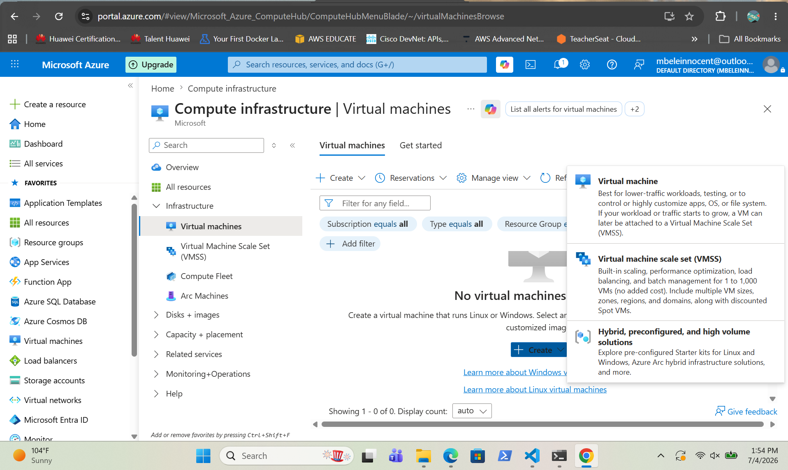
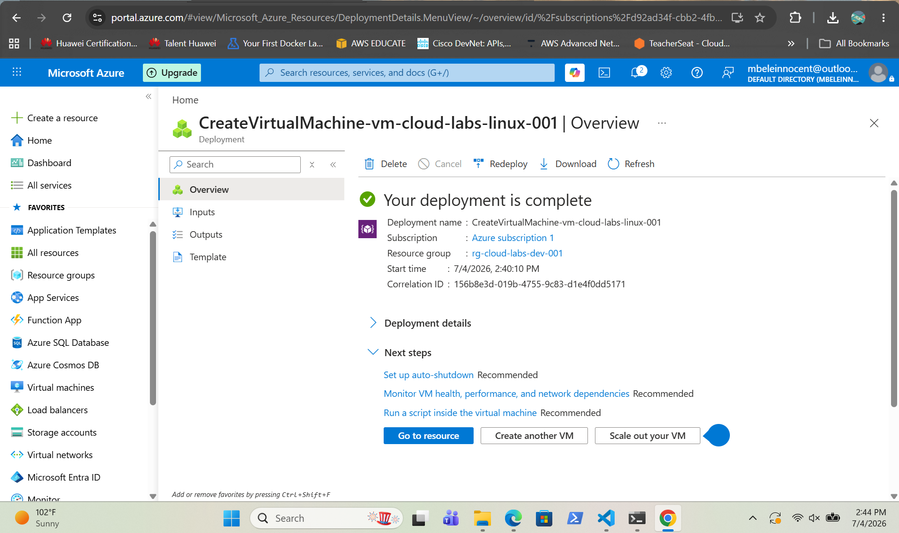
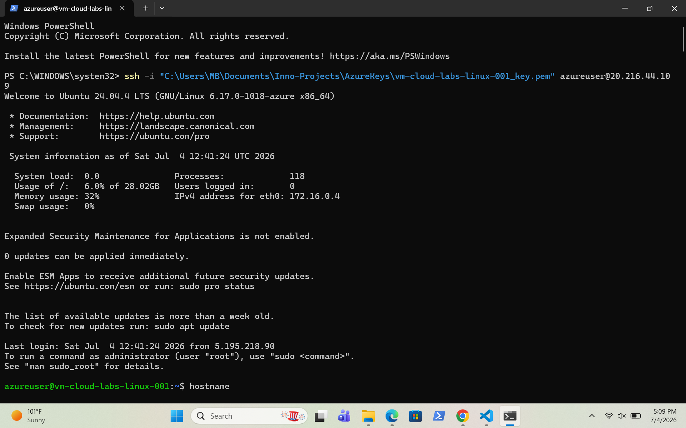
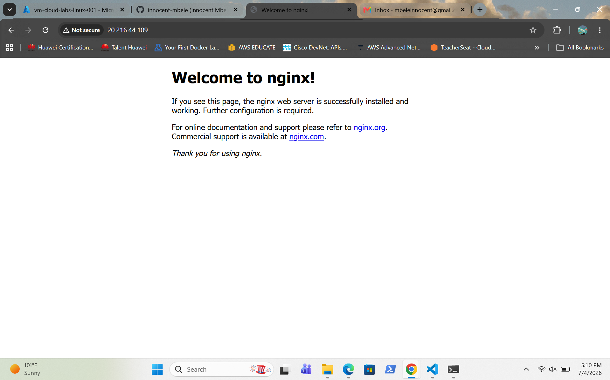
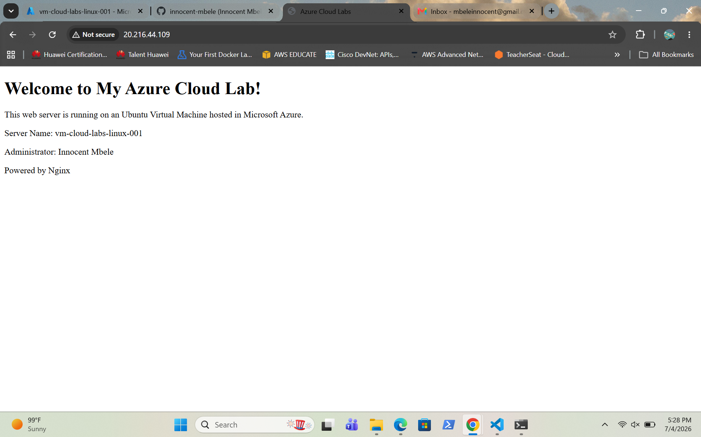

# Azure Linux VM Deployment

## Overview

I demonstrated the deployment of an Ubuntu Linux virtual machine in Microsoft Azure. I configured The virtual machine with SSH key authentication, installed Nginx and configured it and hosted a custom web page to verify successful deployment.

---

## Screenshots

### Creating the Virtual Machine

Shows the Azure configuration before deploying the Ubuntu Linux virtual machine.

---

### Deployment Complete

Shows the successful deployment of the Azure Linux virtual machine.

---

### SSH Connection

Shows a successful SSH connection to the Azure Linux virtual machine using key-based authentication.

---

### Nginx Running

Shows the Nginx web server installed and running successfully on the virtual machine.

---

### Custom Web Page

Shows the custom web page hosted on the Azure Linux virtual machine, confirming the web server is serving application content successfully.

