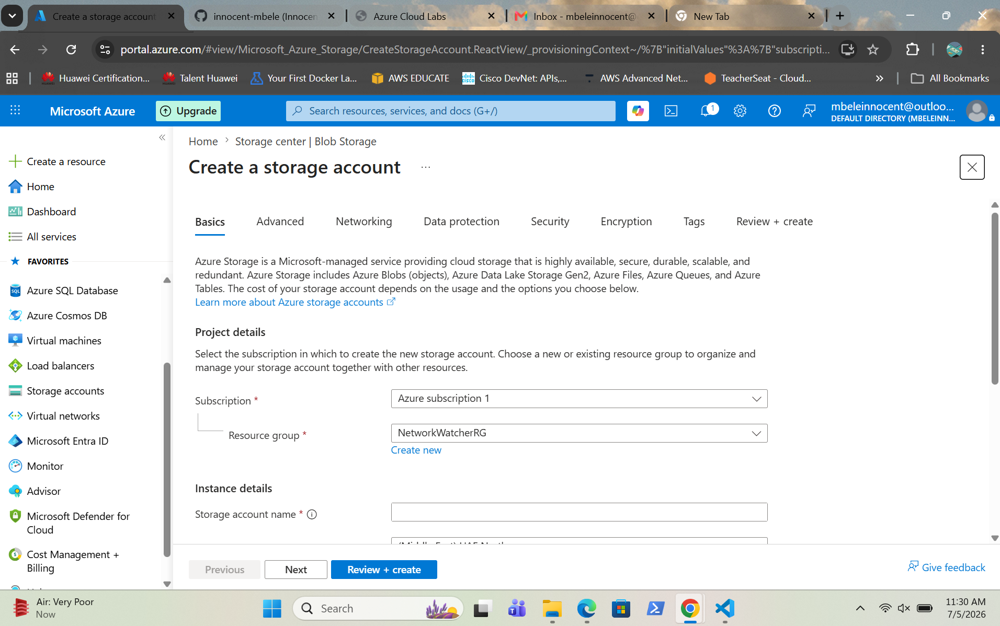
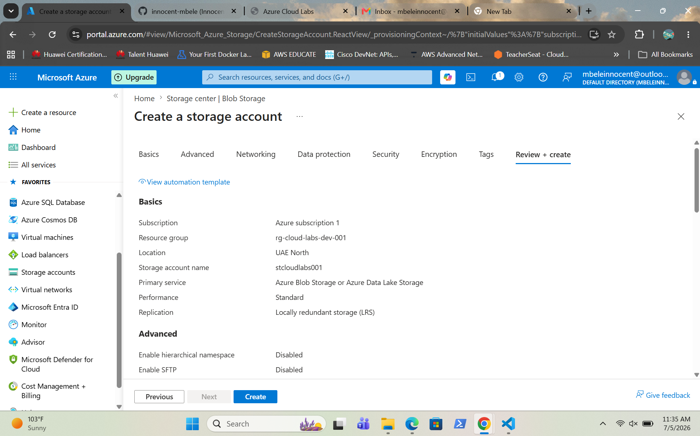
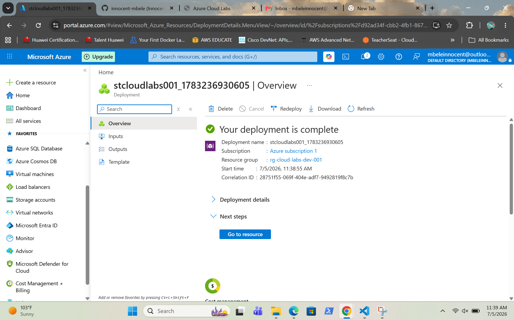
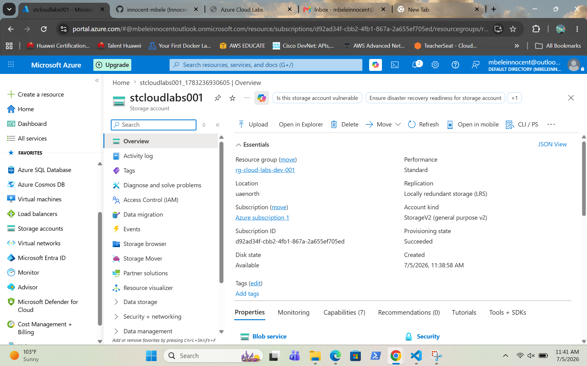
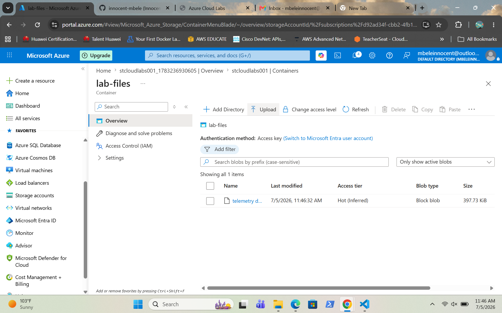

# Azure Storage Account

## Overview

I created an Azure Storage Account and used Azure Blob Storage to store files. I deployed a storage account, created a blob container and uploaded a sample file to verify successful storage configuration.

---

## Screenshots

### Create Storage Account

Shows the configuration before creating the Azure Storage Account.

---

### Review and Create

Shows the Azure deployment summary before creating the Storage Account.

---

### Storage Deployment Successful

Shows the successful deployment of the Azure Storage Account.

---

### Storage Account Overview

Shows the Storage Account properties and configuration after deployment.

---

### Blob Container Overview

Shows the Blob Storage container created within the Storage Account.

